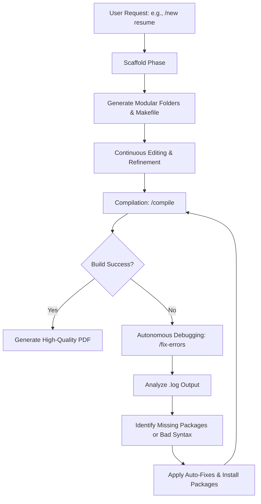

# 🎓 LaTeX Engineer Skill

[](LICENSE)
[](https://tug.org/)
[](#)
[](#agent-support)

Turn your AI coding assistant into a full-blown, autonomous LaTeX engineering department. **LaTeX Engineer Skill** functions as a highly specialized LaTeX project operating system. It allows AI agents to scaffold modular document structures, compile high-quality PDFs, automatically diagnose and resolve LaTeX compiler errors, manage references, and generate ATS-compliant resumes or academic papers.

---

## ⚡ Core Capabilities

- **🚀 Automated Scaffolding:** Instantly generates professional, modular LaTeX layouts including `main.tex`, structured subfolders (`sections/`, `figures/`, `tables/`), dynamic `Makefile` build files, and pre-configured compilation engines.
- **⚙️ Multi-Engine Compiler Pipeline:** Automatically compiles documents using `latexmk`, with built-in configurations for `pdflatex` (standard), `xelatex` (system fonts), and `lualatex` (complex multilingual script rendering).
- **🔍 Self-Healing & Debugging:** Parses compiler log files (`.log`) autonomously when a build fails. It isolates syntax issues, handles missing packages via automated package installations (`tlmgr`), and fixes broken commands without manual intervention.
- **🎯 ATS-Compliant Resume Generation:** Implements layout architectures optimized specifically for Applicant Tracking Systems (ATS) to ensure resumes scan perfectly in automated parsers (single-column format, standard section headings, and table-less tables).
- **📚 Intelligent Citation Management:** Integrates citations directly using `biblatex` and `biber`. Simply provide a DOI or citation key, and the system automatically updates `.bib` catalogs.

---

## 🛠️ Slash Commands

Interact with the LaTeX engineering agent using standard slash commands:

| Command | Action | Example Use Case |
| :--- | :--- | :--- |
| `/new {template}` | Generate a complete, modular folder structure for a given layout | `/new resume` or `/new ieee-paper` |
| `/compile` | Compile the current directory into a high-fidelity PDF document | `/compile` |
| `/fix-errors` | Analyze compilation logs and automatically repair any packages/syntax errors | `/fix-errors` |
| `/optimize-ats` | Review formatting and apply strict rules to maximize ATS readability | `/optimize-ats` |
| `/change-template {to}` | Seamlessly switch and refactor the document class/layout style | `/change-template acm` |
| `/clean-build` | Clean up auxiliary compilation outputs (`.aux`, `.log`, `.out`, etc.) | `/clean-build` |

---

## 🔄 Core Workflow

The diagram below outlines the autonomous compile-debug loop that the LaTeX Engineer runs behind the scenes:



---

## 📋 Prebuilt Templates

The skill includes detailed layout rules and structures for a variety of academic and professional templates:

* **Professional Resumes:** Fully ATS-optimized layouts and Academic CVs using `moderncv`.
* **Academic Papers:** Strict, publication-ready layouts for major venues:
  * **IEEE Conference & Journals** (`IEEEtran` support)
  * **ACM Conference & Journals** (`acmart` support)
  * **Springer LNCS** (`llncs` support)
  * **Elsevier Journals** (`elsarticle` support)
* **Technical Reports & Theses:** Multi-chapter reports and university thesis formats utilizing modular `sections/`.
* **Slides & Presentations:** Clean, elegant slide layouts using the LaTeX `beamer` class.
* **Notes & Lab Reports:** Mathematical formulations using `amsmath`, `amssymb`, and `siunitx`.

---

## 📥 Installation

Install the LaTeX Engineer skill across all compatible agents at once using the automated installer script:

```bash
# Clone the repository and run the install script
git clone https://github.com/shihabshahrier/latex-skill.git
cd latex-skill
bash install.sh
```

### Supported Mappings

The `install.sh` script automatically installs the skill into the following directories:

| Agent / Environment | Target Installation Path |
| :--- | :--- |
| **Claude Code** | `~/.claude/skills/latex-engineer` |
| **opencode** | `~/.config/opencode/skills/latex-engineer` |
| **Gemini CLI (Antigravity)** | `~/.gemini/antigravity/skills/latex-engineer` |
| **Codex / Amp / Goose / Kiro** | `~/.agents/skills/latex-engineer` |
| **OpenClaw** | `~/.openclaw/workspace/skills/latex-engineer` |

*For desktop environments like **Cursor**, **Windsurf**, **Cline**, or **GitHub Copilot**, the prompt rule files in `.cursor/`, `.windsurf/`, `.clinerules`, `AGENTS.md`, and `GEMINI.md` ensure global compatibility.*

---

## ⚡ Prerequisites

To compile PDFs locally, ensure a valid TeX distribution and compiler toolchain are installed:

* **macOS:**
  ```bash
  # Full installation (Recommended)
  brew install --cask mactex
  # Minimal installation
  brew install --cask basictex
  ```
* **Ubuntu / Debian:**
  ```bash
  sudo apt update
  sudo apt install texlive-full latexmk
  ```
* **Fedora / RHEL:**
  ```bash
  sudo dnf install texlive-scheme-full latexmk
  ```
* **Windows:** Install [TeX Live](https://tug.org/texlive/) or [MiKTeX](https://miktex.org/).

---

## 🤝 Contributor Guide

Please help us keep the skill organized and performant. Keep the following source of truth rules in mind:

> [!IMPORTANT]
> **Source of Truth:**
> All modifications should be made **exclusively** to the core definition in `skills/latex-engineer/SKILL.md` and reference files under `skills/latex-engineer/references/`. 

* Do not edit agent-specific config files directly (such as `.cursor/`, `.windsurf/`, `.clinerules`, or `AGENTS.md`). These are automatically synchronized and updated from the main definition.
* Keep the core `SKILL.md` under **5,000 tokens** to prevent context bloating in AI systems. Place deep domain knowledge, code templates, or complex guidelines inside the `references/` directory.

---

## 📄 License

This project is licensed under the [MIT License](LICENSE).